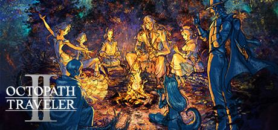

**Octopath Traveler II by Square Enix and Acquire (2023) is a HD-2D JRPG with eight protagonists each with their own story.**

---

## 📖 About

Octopath Traveler II by Square Enix and Acquire (2023) is a HD-2D JRPG with eight protagonists each with their own story. The break-and-boost combat system is the series' best but late-game bosses exploit weakness rotations that require perfectly optimized job assignments.

## ⚠️ Problems Without Trainer

| Problem | Status |
|---------|--------|
| Crossed paths optional boss fights demand near-perfect job and skill setups | ✅ Solved |
| JP grinding for advanced job skills requires hundreds of battles | ✅ Solved |
| License points for secondary jobs locked behind expensive shop prices | ✅ Solved |
| Divine skills cost 50 BP requiring careful multi-turn build-up strategy | ✅ Solved |
| Optional side story unlocks hidden behind long daytime/nighttime action chains | ✅ Solved |

## ✅ Solution

The **Octopath Traveler II Trainer** solves all these issues, giving you complete control so you can focus on enjoying the game.

## 🎯 Features

- Unlimited Resources / Currency
- God Mode / Invincibility
- Instant Skill & Ability Cooldown
- One-Hit Kill
- Freeze Timers
- Unlock All Items & Achievements
- Custom Speed Multiplier
- Infinite Stamina / Energy

## 🚀 Quick Start

1. **Disable Windows Defender** temporarily (trainer may trigger false positive)
2. Get the trainer from the button above
3. Launch Octopath Traveler II
4. Run the trainer as Administrator
5. Use the hotkeys to activate cheats in-game

## 💎 Free vs Pro

| Feature | Free | Pro |
|---------|------|-----|
| God Mode | ✅ | ✅ |
| Unlimited Resources | ✅ | ✅ |
| Advanced Cheats | ❌ | ✅ |
| Auto-Updates | ❌ | ✅ |
| Priority Support | ❌ | ✅ |

## 💻 Requirements

- Windows 10 / 11 (64-bit)
- Octopath Traveler II (any version)
- .NET Framework 4.8+
- DirectX 11+

## 🍎 macOS

## ⚖️ Legal

Educational and single-player use only.

---

